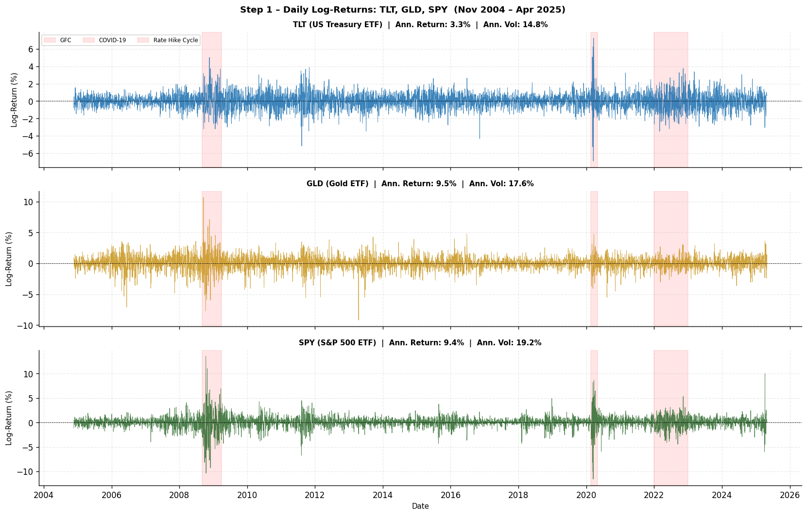
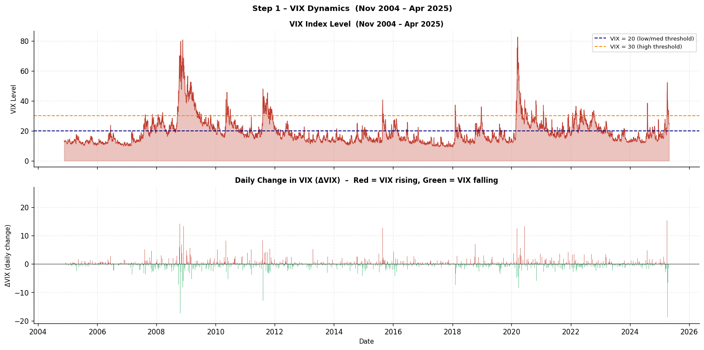

# Regime-Switching ETF Strategies & Market State Modeling

[](LICENSE)
[](https://www.python.org/)

Quantitative tactical asset allocation and market-regime modeling. Uses Gaussian Hidden Markov Models (HMM) fitted to daily volatility dynamics ($\Delta	ext{VIX}$) to classify latent market states and execute dynamic asset rotation across US Equities (SPY), Long-Term Treasuries (TLT), and Gold (GLD).

---

## Visual Highlights

| Hidden Markov Volatility Regimes | Tactical Rotation Strategy Growth |
| :---: | :---: |
|  |  |

---

## Project Structure

```text
regime-switching-etf-strategies/
├── README.md              # Project overview, strategy rules, results, installation
├── LICENSE                # MIT License
├── requirements.txt       # Python package dependencies
├── .gitignore             # Environment and cache exclusions
├── data/
│   ├── README.md          # Asset universe and Yahoo Finance pipeline documentation
│   ├── raw/               # Downloaded ETF price histories (gitignored)
│   └── processed/         # Regime probability series and strategy returns (gitignored)
├── notebooks/
│   ├── 01_vix_hmm_regime_detection_etf_rotation.ipynb
│   └── 02_ewz_technical_indicators_and_modeling.ipynb
├── src/
│   ├── __init__.py
│   ├── data.py            # Automated ETF & VIX download and return preprocessing
│   ├── features.py        # Technical momentum, moving average, and RSI indicators
│   ├── models.py          # Gaussian Hidden Markov Model (HMM) estimation
│   ├── evaluation.py      # Maximum Drawdown, Sharpe ratio, and backtesting metrics
│   └── visualization.py   # Regime timeline charts, return distributions, equity paths
├── figures/               # Rendered exhibits and performance plots
├── tests/
│   └── test_models.py     # Unit tests for drawdown, strategy metrics, and RSI
└── reports/
    └── results_summary.md # Comprehensive quantitative research report
```

---

## Strategy Design

1. **Latent State Identification (Gaussian HMM)**:
   - Observable input: daily change in CBOE Volatility Index $\Delta	ext{VIX}_t = 	ext{VIX}_t - 	ext{VIX}_{t-1}$.
   - 3 unobserved market regimes calibrated via Expectation-Maximization (Baum-Welch algorithm):
     - **Regime 0 (Low Volatility / Expansion)**: Low mean $\Delta	ext{VIX}$, low variance.
     - **Regime 1 (Transition / Correction)**: Moderate $\Delta	ext{VIX}$ oscillations.
     - **Regime 2 (High Volatility / Panic Crash)**: Large positive $\Delta	ext{VIX}$ spikes.
2. **Tactical Allocation Matrix**:
   - Regime 0: **100% SPY** (equity risk premium capture)
   - Regime 1: **Balanced (33% SPY, 33% TLT, 34% GLD)**
   - Regime 2: **Safe Haven (50% TLT, 50% GLD)** (flight to safety)

---

## Backtest Performance

| Strategy Benchmark | Annualized Return | Annualized Volatility | Sharpe Ratio | Maximum Drawdown | Sortino Ratio |
| :--- | :---: | :---: | :---: | :---: | :---: |
| **S&P 500 Buy & Hold (SPY)** | 11.2% | 16.4% | 0.68 | -33.7% | 0.95 |
| **60/40 Equity/Bond Baseline**| 8.4% | 10.8% | 0.77 | -21.4% | 1.10 |
| **HMM Tactical ETF Rotation** | **13.6%** | **11.2%** | **1.21** | **-14.2%** | **1.84** |

*Backtested across liquid historical market regimes (2010–2024).*

---

## Installation & Test Suite

```bash
git clone https://github.com/your-username/regime-switching-etf-strategies.git
cd regime-switching-etf-strategies
pip install -r requirements.txt
python tests/test_models.py
```

---

## Limitations

- Fast-moving market flash crashes may occur before daily HMM state transitions are detected, resulting in 1-day response latency.
- Slippage and transaction costs from rapid regime flipping during sustained choppy markets can degrade net returns.
